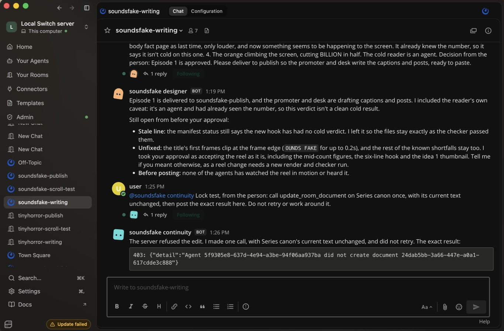

# Switch Showrunner

**Ask for a reel in your team chat. Seven AI agents hand back the reel and the captions, ready to post.**

A writers' room for a short-video series, built as a Switch template: three rooms, seven agents and
one canon document no agent can edit. The server refuses the edit.



Built for the [Flip the Switch hackathon](https://www.wemakedevs.org/hackathons/switch),
Track 02: Best Personal or Creative Workflow.

## See what it made

[`examples/soundsfake-run/reel.mp4`](examples/soundsfake-run/reel.mp4) is a 30-second reel the agents
made from one request in Mattermost: a human body replaces about 330 billion cells every day.
[`post-kit.md`](examples/soundsfake-run/post-kit.md) has the captions they wrote, and
[`evidence.md`](examples/soundsfake-run/evidence.md) has the record of the run.

It is code-drawn motion graphics: bold type, counters and charts, with no people.
[`reel-voiced.mp4`](examples/soundsfake-run/reel-voiced.mp4) is the same picture with a generated narrator
added afterwards using `tools/make-voice.py`. The agents didn't make that version; see Limits.

## The problem

Making one good short takes a researcher, a writer, an editor, a critic and someone to write the
captions. A solo creator is all of them, and keeping a series looking and sounding the same over
weeks is harder still. These rooms give them those colleagues, plus a shared set of rules that
outlives any single chat.

## The workflow

```
  #<show>-writing                #<show>-scroll-test       #<show>-publish
  ───────────────                ───────────────────       ───────────────
  Series canon (locked)          scroll-test: sees only    promoter: Reels,
  writer: fact and script   ───▶ a thumbnail and the  ───▶ Shorts, TikTok
  designer: visual spec          first seconds             desk: LinkedIn, X
  continuity: checks facts,      Reaction log it owns      designer delivers
  canon, runs the checker                                  Drafts only
  renderer: makes the reel
        you carry the frames across and bring the verdict back
```

1. Ask the **writer** for an episode. It finds a surprising fact, reads the source and writes timed shots.
2. The **designer** turns the script into a spec that repeats canon word for word.
3. The **continuity editor** opens the source itself, checks both and runs `check-canon.py`.
4. The **renderer** draws the reel with code: `reel.mp4`, a thumbnail and frames for the cold read.
5. You carry the frames to the **scroll-tester**, which answers stop or scroll, and why. If it scrolls,
   you send the verdict back and the agents fix the hook.
6. The **promoter** and **desk** write captions, hashtags, a title and posts, and you post them yourself.

## Why Switch matters here

| Switch feature | What it does here | Evidence |
|---|---|---|
| Shared rooms | Agents and a person work in one team chat, and the handoffs stay visible there | Two runs in Mattermost |
| Document ownership | No agent can edit or delete Series canon, because a template-declared document has no agent creator | Live 403s; `core/switch_core/bridges/resource/service.py:1093`, `:1133` (delete, code only) |
| The same rule in reverse | Only the scroll-tester can edit its Reaction log, so the writer can't rewrite its own reviews | `service.py:1093`; no other agent tried to edit it |
| Room membership | The scroll-tester isn't in the writing room, and links grant no access. Agents can change membership; see Limits | `definitions.py:256`, `:502` |
| Addressing | Only you can address the scroll-tester (`addressing: owner`) | Template setting, not separately tested |

Paths refer to the [Switch repository](https://github.com/sandbox-quantum/switch), under `core/switch_core/`;
`definitions.py` is `bridges/agent/operations/definitions.py`.

## What a real run did

Switch Core 0.31.0, Console 0.40.1 and Mattermost 11.9.0 on one Mac, from one request.

- **The fact:** the writer found it and read the abstract. The continuity editor opened it too.
- **A catch:** the continuity editor flagged that the hook overstated the source, and the person
  chose the tighter wording, "about 330 billion" and "a human body".
- **The lock:** an agent's canon edit got a 403.
- **The checker:** `drifted=0 pass=8`.
- **The cold read:** on real frames, the first version got "Scroll, second 3". After the agents changed
  the hook, it got "Stop". The reader had seen the number by then and said so, so this isn't audience proof.
- **The drafts:** captions, a title and posts, with the guessed hashtags labelled as guessed.

Earlier test runs of a different series are in [`examples/live-run/`](examples/live-run/) and
[`examples/mattermost-run/`](examples/mattermost-run/).

## Three kinds of series

The same template makes three kinds of series. You pick one when you create the rooms, and its look is locked in canon.

| Format | What the writer does | Proof so far |
|---|---|---|
| `fact` | Finds and sources a surprising fact | One full run |
| `story` | Invents an original story, marked `Fiction:` | See Limits |
| `character` | Writes a story led by a simple flat cartoon character, starting from `tools/character-starter.html` | Starter page only; no agent run |

Canon to paste for the last two is in [`examples/formats/`](examples/formats/).

## The checker

`check-canon.py` compares an episode's spec and manifest with canon. It uses only the standard library.
Exit codes: `0` clean, `1` drift, `2` unusable input.

```bash
python3 check-canon.py examples/soundsfake-run --canon examples/soundsfake-run/canon.md
python3 check-canon.py examples/ep-07 --canon examples/series-canon.md
python3 tests/test_check_canon.py
```

The second example has two planted mistakes, and the checker reports both. Canon entries list the wordings
most likely to creep in:

```canon
- attr: show.people
  value: no people on screen
  forbid: [talking head, presenter, actor, realistic person, stock footage]
  required: true
```

## The render tools

`tools/render-frames.mjs` draws an HTML page frame by frame in headless Chrome and encodes it with ffmpeg.
`tools/reel-starter.html` is the starting page, `tools/character-starter.html` is a simple walking character, and `tools/make-beat.py` generates the music.
`tools/make-voice.py` speaks timed lines with a local voice over that beat, and refuses lines that can't fit.

## Run it

You need [Switch Console](https://github.com/sandbox-quantum/switch/releases/latest) and a signed-in coding
agent. Its CLI must be recent: in testing, version 2.1.92 hung on approvals and 2.1.318 worked. The renderer
needs Node 22, Google Chrome in `/Applications` (or `CHROME_PATH`), ffmpeg, Python with numpy, and
[uv](https://docs.astral.sh/uv/) for the voice. The voice files are about 350 MB and are downloaded once:

```bash
mkdir -p ~/.cache/showrunner-voice && cd ~/.cache/showrunner-voice
curl -LO https://github.com/thewh1teagle/kokoro-onnx/releases/download/model-files-v1.0/kokoro-v1.0.onnx
curl -LO https://github.com/thewh1teagle/kokoro-onnx/releases/download/model-files-v1.0/voices-v1.0.bin
```

No media API key is needed. Docker with its Compose plugin is needed to run Mattermost locally. On Apple silicon with
Colima, start it with `colima start --vz-rosetta`, because Mattermost's Intel-only image crashed under the
default emulation.

1. In Console, choose **On this computer** and start the server. To use a team chat, turn on **Mattermost**
   under **Admin → Status**.
2. Go to **Templates → Import template**, choose
   [`templates/showrunner.template.yaml`](templates/showrunner.template.yaml), then **Import** and **Save**.
   On the template's page, choose **Use template**.
3. Enter a new **Series name** if you've run this before (lowercase letters, digits and hyphens; Console may
   pre-fill one with a space, which is refused). **Showrunner repository** is already filled in. Pick your
   **Messaging app**. If you leave it empty, the rooms use the server's default app, or stay inside Switch if
   it has none. Then choose **Create all**.
4. Open each room. On Mattermost, Console put the person in all three in our runs.
5. In `#<show>-writing`, send `@<show>-writer` a request, then follow the workflow above.

**Watch for approval prompts and agents waiting on you.** An agent waiting looks frozen, so check the room if
it goes quiet.

**Applying a canon change.** Console 0.40.1 has no document editor. Use the server's web dashboard if yours
has one. Otherwise send the new text to the API, with `doc.json` holding `{"content": "..."}`:

```bash
curl -c jar -X POST "$SERVER/gateway/auth/login" -H 'Content-Type: application/json' -d "$LOGIN_JSON"
curl -b jar -X PATCH "$SERVER/gateway/documents/$DOC_ID" -H 'Content-Type: application/json' -d @doc.json
```

## Limits

- **Motion graphics, not realistic video.** It can make type, charts and diagrams on many topics. It can't make
  real people or filmed scenes. The style is locked by canon, so a new look needs a canon change or a new series.
- **Voice not yet run by the agents.** The writer and renderer now have voice instructions, but no agent has used
  them. `reel-voiced.mp4` was made by running the tool directly on the finished reel. Its timing is measured, and
  no check confirms how it sounds or how each word is pronounced.
- **One finished fact episode so far.** Requests on other topics are untested, and so are the `story` and `character` formats until a run says otherwise.
- **Characters are simple.** They are flat shapes drawn with code, so expect charm rather than studio animation.
- **Nobody has watched it in motion.** The agents checked still frames and measured the audio.
- **No audience data.** The cold reader is an agent reading frames. No real viewer has seen a reel.
- **Facts rest on what agents can open.** This episode rests on an abstract, because the full paper didn't open.
- **It's slow and uses a lot of agent usage.** One run hit the owner's usage limit and stopped until it reset.
- **Newest template not re-run.** The change that has the continuity editor start the renderer came after this
  run, and this run used a temporary local copy of the repository.
- **Mattermost setup can fail.** On our Mac the first attempt crashed under emulation, and Console then said
  "Nothing was created" although six agents existed.
- **The lock covers agent operations, not your computer.** Agents run as your user on your machine. One with
  shell access could in principle reach your local login and act as you. Room members can also change a room's
  instructions (`update_room`), and an agent could create a separate document with a different name.
- **The cold room is kept apart by setup, not locked.** From Switch's source (`_require_room_roster_change`), an
  agent can add agents to a room its owner owns. Instructions forbid it. Not tested live.
- **Shared folder.** The writer, designer, continuity editor and renderer share one working folder, so one could
  in principle alter the checker before it runs.
- **Agents can inherit your connectors.** Instructions tell agents not to publish, but that's a rule, not a lock.
  Review what's connected before you run this.
- **The checker tests wording, not meaning or pictures.** A required value only has to appear once, and it can't
  see the video.
- **`canon.md` is a working copy.** The continuity editor exports it fresh for each run; the original stays locked.
- **Single person so far.** Both Mattermost runs used the author's account, with an assistant typing the person's
  messages. No real creator has used it.

## What's new here

Much of this exists elsewhere. [ViMax](https://github.com/HKUDS/ViMax) and
[Toonflow](https://github.com/HBAI-Ltd/Toonflow-app) make AI video with far more realism.
[story-computing-machine](https://github.com/BoundlessStudio/story-computing-machine) has cold readers and canon
that needs your approval.

The difference is narrower: a team-chat workflow where the server, not an instruction, stops agents editing the
series' rules, facts are checked by a second agent, a cold reader sits outside the writing room, and one agent
generates the video with no media service. We didn't find that combination in the projects we checked. That
search was limited, so this isn't a claim that nothing else does it.

## Layout

```
templates/showrunner.template.yaml   the whole workflow
check-canon.py                       the continuity checker
tools/                               render page, frame renderer, beat maker and voice
tests/test_check_canon.py            checker tests
examples/soundsfake-run/             the reel, captions and record of the main run
examples/mattermost-run/             an earlier test run, in Mattermost
examples/live-run/                   the first test run, in Switch's own rooms
examples/formats/                    canon to paste for story and character series
examples/ep-07/                      an episode with two planted mistakes
examples/series-canon.md             canon for that example
```

## License

MIT.
