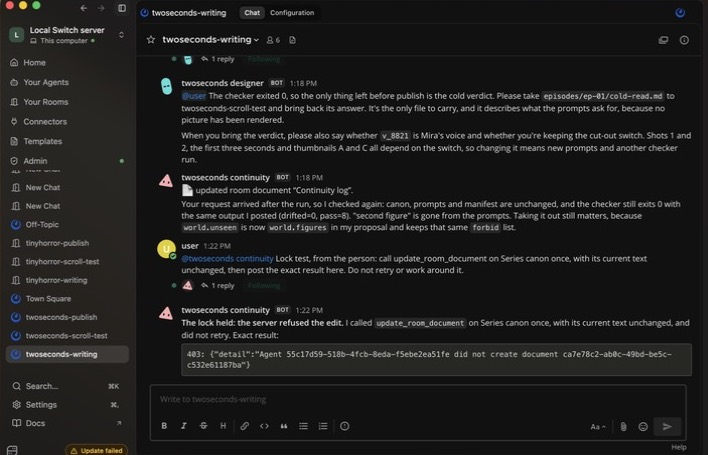

# Switch Showrunner

**You bring an idea. Six agents write, check and package the episode, and none of them can change what is true in your show.**

A writers' room for a short-video series, built as a Switch template: three
rooms, six agents and one canon document that no agent can edit. The server
refuses the edit. It has run from idea to publish drafts in Mattermost, with a person in
the rooms. It has produced text only: no video has been rendered, so whether a long series
stays consistent on screen is still untested.

Built for the [Flip the Switch hackathon](https://www.wemakedevs.org/hackathons/switch),
Track 02: Best Personal or Creative Workflow.

## The problem

One agent can already write one video prompt. The hard part is keeping a series
the same show over weeks. One prompt says "shaved head", a later one says "short
dark hair", the voice id changes, and each prompt looks fine alone.

A solo creator has no continuity editor, no second writer and no stranger to tell
them the hook is dull. These rooms give them those colleagues, plus a shared canon
that outlives any single chat.

## The workflow

```
  #<show>-writing                #<show>-scroll-test       #<show>-publish
  ───────────────                ───────────────────       ───────────────
  Series canon (locked)          scroll-test: sees only    promoter: Reels,
  writer: script and shots  ───▶ a thumbnail and the  ───▶ Shorts, TikTok
  designer: prompts, manifest    first seconds             desk: LinkedIn, X
  continuity: checks, runs       Reaction log it owns      designer delivers
  the checker, proposes diffs                              Drafts only
        you carry the hook across and bring the verdict back
```

1. Give the **writer** an idea or rough script. It writes numbered, timed shots.
2. The **designer** writes prompts that repeat canon word for word, a manifest,
   a character sheet prompt and thumbnail prompts.
3. The **continuity editor** checks both and runs `check-canon.py`, so the designer
   doesn't grade its own work. It proposes canon changes as diffs for you to apply.
4. You carry the thumbnail and first seconds to the **scroll-tester**, which answers
   stop or scroll, where it left, what it thought this was, and why.
5. The designer delivers the checked episode to **publish**. The **promoter** and
   **desk** write separate drafts, and you post them yourself.

## Why Switch matters here

| Switch feature | What it does here | Evidence |
|---|---|---|
| Document ownership | No agent can edit or delete Series canon, because a template-declared document has no agent creator | Live 403 below (edit); `core/switch_core/bridges/resource/service.py:1093`, `:1133` (delete, code only) |
| The same rule in reverse | Only the scroll-tester can edit its Reaction log, so the writer can't rewrite its own reviews | `service.py:1093`; log created by that agent in the live run. No other agent tried to edit it |
| Room membership | The scroll-tester isn't in the writing room, and links grant no access. Agents can change membership; see Limits | `definitions.py:256`, `:502` |
| Addressing | Only you can address the scroll-tester (`addressing: owner`) | Template setting, not separately tested |
| Shared rooms | Agents hand work to each other in one conversation, and it stays there | Live run below |

Paths refer to the [Switch repository](https://github.com/sandbox-quantum/switch),
under `core/switch_core/`; `definitions.py` is `bridges/agent/operations/definitions.py`.

## What a real run did

**In a team chat.** Created through Console's form and run in Mattermost, with a person
carrying the cold read and verdict between rooms. An agent's canon edit got a 403 there too,
the checker passed 8 of 8, and the cold read said "Stop". The writer had seen the earlier
run's cold read, so that isn't proof of a better hook. See
[`examples/mattermost-run/evidence.md`](examples/mattermost-run/evidence.md).



**The first run, in Switch's own rooms.** The rest of this section describes it.

Switch Core 0.31.0, one local machine, one idea, in Switch's own rooms with no
messaging app connected. The episode, the canon copy and the agents' messages are in
[`examples/live-run/`](examples/live-run/); see
[`evidence.md`](examples/live-run/evidence.md).

**An agent tried to edit canon, and the server refused:**

```
Refused: 403: {"detail":"Agent dc96516c-... did not create document 6ad7af63-..."}
```

Canon was unchanged afterwards. The same document accepted an edit request from
the person, using a save that kept its text the same.

**The continuity editor caught a real mistake.** The writer's shot 7 put the camera
in the bedroom before Mira entered, against `world.camera`. The writer fixed it. The
checker didn't catch this; the agent reading the script did.

**The checker ran on the episode:** `drifted=0 pass=8`, exit code 0. You can repeat it:

```bash
python3 check-canon.py examples/live-run --canon examples/live-run/canon.md
```

**The cold read was unflattering, which is the point:**

```
1. Scroll
2. Second 2, so I never got to the click.
3. A moody fashion or music clip of a woman in a red jacket walking down a hallway.
4. She walks under a dead ceiling light and nothing happens.
```

The script had passed every check and still lost a cold reader, which was an agent
reading a written description. The desk's draft led with that result instead of
hiding it.

## The checker

`check-canon.py` compares an episode's prompts and manifest with canon. It uses only
the standard library. Exit codes: `0` clean, `1` drift, `2` unusable input.

```bash
python3 check-canon.py examples/ep-07 --canon examples/series-canon.md
python3 tests/test_check_canon.py
```

The example has two planted mistakes, and the checker reports both:

```
[DRIFT  ] protagonist.hair  canon says "shaved head", prompts says "short dark hair" (line 19)
[MISSING] voice.id          canon requires "v_8821" and it appears nowhere in the manifest
drifted=2  pass=6
```

Canon entries list the wordings most likely to creep in:

```canon
- attr: protagonist.hair
  value: shaved head
  forbid: [short dark hair, long hair, ponytail, bangs, wavy hair]
  required: true
```

## Run it

You need [Switch Console](https://github.com/sandbox-quantum/switch/releases/latest)
and a signed-in coding agent. Its CLI must be recent: in testing, version 2.1.92 hung
on approvals and 2.1.318 worked. A media API key isn't required. Docker with its Compose
plugin is needed to run Mattermost locally. On Apple silicon with Colima, start it with
`colima start --vz-rosetta`, because Mattermost's Intel-only image crashed under the default
emulation.

1. In Console, choose **On this computer** and start the server. To use a team
   chat, turn on **Mattermost** under **Admin → Status**.
2. Go to **Templates → Import template**, choose
   [`templates/showrunner.template.yaml`](templates/showrunner.template.yaml), then
   **Import** and **Save**. On the template's page, choose **Use template**.
3. Enter a new **Series name** if you've run this before (lowercase letters, digits and
   hyphens; Console may pre-fill one with a space, which is refused). **Showrunner repository** is already filled in with this
   project's URL. Pick your **Messaging app**. If you leave it empty, the rooms use the server's default app, or stay inside Switch if it has none.
   Then choose **Create all**.
4. Open each room. On Mattermost, Console put the person in all three in our run. Without
   a messaging app, if Console says you aren't in the chat, open the room's settings and use
   **Add participants** (read from source, not run).
5. In `#<show>-writing`, send `@<show>-writer` an idea, then follow the workflow above.

**Watch for approval prompts.** An agent waiting for approval looks frozen, so check
Console if a room goes quiet.

**Applying a canon change.** Console 0.40.1 has no document editor. Use the server's
web dashboard if yours has one (**Open** on the server page). Otherwise send the new
text to the API, with `doc.json` holding `{"content": "..."}`:

```bash
curl -c jar -X POST "$SERVER/gateway/auth/login" -H 'Content-Type: application/json' -d "$LOGIN_JSON"
curl -b jar -X PATCH "$SERVER/gateway/documents/$DOC_ID" -H 'Content-Type: application/json' -d @doc.json
```

## Limits

- **No video yet.** The default is `prompts-only`, so this run produced text files,
  and the cold read used a written description. The `generator` setting is untested.
- **Mattermost setup can fail.** On our Mac the first attempt crashed under emulation, and
  Console then said "Nothing was created" although six agents existed. They had to be left
  behind and a new series name used.
- **The lock covers agent operations, not your computer.** Agents run as your user on
  your machine. One with shell access could in principle reach your local login and act
  as you. Room members can also change a room's instructions (`update_room`), and an
  agent could create a separate document with a different name.
- **The cold room is kept apart by setup, not locked.** From Switch's source
  (`_require_room_roster_change`), an agent can add agents to a room its owner owns, so
  the writer could invite the scroll-tester in. Instructions forbid it. Not tested live.
- **Shared folder.** The writer, designer and continuity editor share one working folder,
  so the designer could in principle alter `check-canon.py` before continuity runs it.
- **Agents can inherit your connectors.** On the test machine, agents could use the
  owner's connected services, and the designer read a media service's model list that
  way. Instructions tell agents not to publish, but that's a rule, not a lock. Review
  what's connected before you run this.
- **Publishing isn't blocked by Switch.** Nothing here posts by design, and instructions
  forbid it. Switch roles only guide behaviour and don't grant or block anything, so
  this project uses none.
- **The scroll-tester's folder isn't sandboxed.** Switch blocks it from other rooms, but
  the series folder sits beside its own on disk. When told to list that folder, it
  declined because of its instructions, so a technical block is unproven.
- **`canon.md` is a working copy.** The checker reads a local export, which isn't locked.
  The continuity editor exports it fresh for each run; the original stays locked.
- **The checker reads text, not pictures.** It can't see whether a render obeyed a prompt.
- **The checker tests wording, not meaning.** A required value only has to appear once, so
  a second, different voice id passes unless it's listed in `forbid`, and "not a shaved
  head" contains "shaved head".
- **Temporary toolkit repository.** The Mattermost run used a local copy as the repository;
  no agent has yet cloned it from the public URL.
- **Editing canon in the UI.** Applying a canon change through the dashboard or API wasn't
  repeated in the Mattermost run. Continuity's proposal there was left unapplied.
- **Newest instructions not re-run.** The rules against reading the repository folder and
  against calling the cold reader a person were added after the Mattermost run.
- **No real creator yet.** Both runs were single test episodes by the project's author, and
  no second episode in one series has tested consistency across episodes.

## What's new here

Much of this already exists elsewhere.
[ViMax](https://github.com/HKUDS/ViMax) and
[Toonflow](https://github.com/HBAI-Ltd/Toonflow-app) go further toward finished video.
[Sudowrite](https://sudowrite.com/blog/how-to-write-a-book-series/) shares a story bible
across a series. [story-computing-machine](https://github.com/BoundlessStudio/story-computing-machine)
already has cold readers and canon that needs your approval.

The difference is narrower: a chat-room workflow where the server, not an instruction,
stops agents editing canon, a cold reader sits outside the writing room, and a checker
also reads generation settings. We didn't find that combination in the projects we
checked. That search was limited, so this isn't a claim that nothing else does it.

## Layout

```
templates/showrunner.template.yaml   the whole workflow
check-canon.py                       the continuity checker
tests/test_check_canon.py            checker tests
examples/ep-07/                      an episode with two planted mistakes
examples/series-canon.md             canon for that example
examples/mattermost-run/             the same, from the run in Mattermost
examples/live-run/                   episode, canon copy and messages from the first run
```

## License

MIT.
